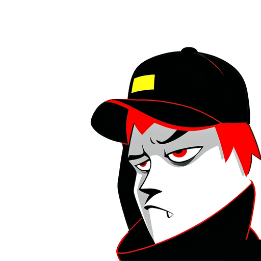

<p align="center">
  
</p>

<h1 align="center">BobbyCat</h1>
<h3 align="center">免费、开源、跨平台的视频编辑器</h3>

<div align="center">

<p align="center">
  <a href="https://github.com/bobby663698/bobbycat/releases"></a>
  <a href="https://github.com/bobby663698/bobbycat/releases"></a>
  <a href="LICENSE"></a>
  <a href="https://github.com/bobby663698/bobbycat/discussions"></a>
</p>

</div>

## 这是什么

BobbyCat 是一款完全在本机运行的视频编辑器，覆盖大多数剪辑需要的东西：自动字幕、文字转语音与音色克隆、抠像换背景、关键帧动效、特效与标题、多轨道剪辑、4K 导出。

没有水印、没有账号、没有订阅、没有上传。装好就能剪，素材一步都不离开你的硬盘。字幕、配音、抠像要用的模型在设置里下载一次，之后离线可用。

适合：抖音、Reels、Shorts 竖屏短片，YouTube 长视频，教程与录屏，播客片段，表情包。

**也面向机器：** 内置 MCP 服务（`bobbycat --mcp`，配置见 [docs/MCP.md](docs/MCP.md)）与 JSON-RPC 接口，脚本和 AI 代理都能直接驱动它剪片。

## 功能

- 🚫 **无水印、无账号、无付费墙。**
- 🔒 **100% 本地。** 不上传，断网可用。
- 💬 **自动字幕。** 本机生成，选模型大小，样式直接落在时间线上。
- 🗣️ **文字转语音 + 音色克隆。** 桌面端免费本地音色，或用几秒录音克隆任意音色。
- 🧍 **抠像。** 人物、物体，或者自己刷蒙版。
- 🎞️ **关键帧。** 位置、缩放、旋转、不透明度、音量、特效参数，自带曲线编辑器。
- ✨ **100 款特效、滤镜与转场。** 预览里实时看。
- ✂️ **快速剪辑。** 分割、修剪、波纹、合并、定格、变速，磁吸时间线可选。
- 🎚️ **多轨道、多时间线。** 画中画与叠加：视频、图片、标题随便叠。混合模式（滤色、相加、正片叠底）、裁切、翻转。
- 📝 **标题。** 字体、描边、阴影、底板，带预设。
- 🎙️ **一键修音。** 降噪、人声增强、响度对齐，另有花栗鼠、机器人、电话音。
- 📤 **导出。** H.264、HEVC、AV1，最高 4K 60、10-bit 色彩。
- ⚡ **流畅。** 内置代理文件，4K 素材拖动不卡。
- 🤖 **可脚本化。** 内置 MCP 服务与 JSON-RPC 接口，源码构建另有 gRPC 与命令行工具 `bobbycat-cli`。
- 🖥️ **Windows、macOS、Linux、Android。** 26 种界面语言，同一套项目文件。

## 下载

到 **[Releases](https://github.com/bobby663698/bobbycat/releases)** 取对应平台的安装包：

| 平台 | 文件 |
| --- | --- |
| Windows x86_64 | `BobbyCat-<版本>-windows-x86_64-setup.exe`、`BobbyCat-<版本>-windows-x86_64.msi` |
| macOS（Intel / Apple silicon） | `.dmg` |
| Linux x86_64 / ARM | `.deb`、`.rpm`、`.AppImage` |
| Android | `.apk` |

Windows 构建暂未做代码签名，SmartScreen 会拦一下：**更多信息** › **仍要运行**。macOS 上遇到未签名拦截：

```sh
xattr -dr com.apple.quarantine /Applications/BobbyCat.app
```

## 从源码构建

需要 Rust 1.93 或更新（见 `src/Cargo.toml` 的 `rust-version`）、FFmpeg 7+ 开发库、cmake 和一个 C++ 编译器。

- **Windows：** 从 [FFmpeg 官方下载页](https://ffmpeg.org/download.html#build-windows) 取 BtbN 的 `win64-gpl-shared` 构建，解压后把 `FFMPEG_DIR` 指向它
- **macOS：** `brew install ffmpeg`
- **Linux：** 用发行版自带的 FFmpeg（7 以上），否则同 Windows 用 BtbN `shared` 构建并设 `FFMPEG_DIR`

```sh
cd src
cargo run -p concat                    # 打开编辑器
cargo build --profile app -p concat    # 发布版二进制（fat LTO，已 strip）
cargo test                             # 测试
cargo fmt --check && cargo clippy --all-targets -- -D warnings
```

改了界面文案，跑一次 `python3 scripts/locales.py` 让字符串清单保持同步。

音效库由 `python3 tools/make_audio.py` 生成（全部为本地合成，CC0-1.0，无第三方素材）。

## 反馈与讨论

- 提 Bug、要功能：[Issues](https://github.com/bobby663698/bobbycat/issues/new)
- 用法、作品、想法：[Discussions](https://github.com/bobby663698/bobbycat/discussions)
- 接口文档：`docs/` 目录，MCP 见 [docs/MCP.md](docs/MCP.md)

## 许可

- 本体以 [AGPL-3.0-or-later](LICENSE) 发布。
- 闭源商用需要商业授权，见 [LICENSING.md](LICENSING.md)。
- 内置音效库为本项目自行合成，CC0-1.0。
