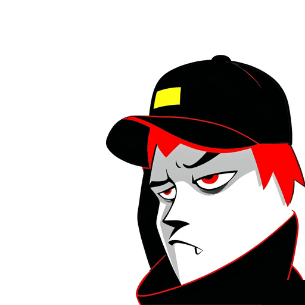

  

<h1 align="center">BobbyCat</h1>
<h3 align="center">Penyunting video yang gratis, sumber terbuka, dan lintas platform.</h3>

  <a href="../README.md">English</a> &middot; <strong>Bahasa Indonesia</strong>

---

BobbyCat is a video editor that runs entirely on your own machine: captions,
voice, cutout, effects, keyframes and 4K export, with no watermark, no account
and no upload.

The maintained documentation is the [English README](../README.md). Windows
installers are published on the
[Releases](https://github.com/bobby663698/bobbycat/releases) page.
